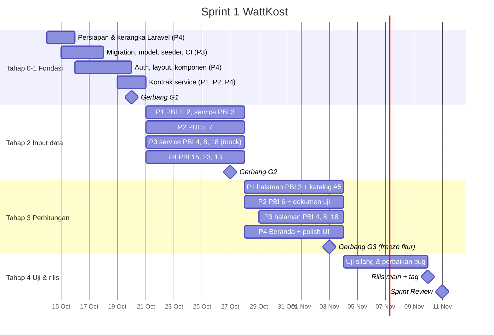

# Tahapan Sprint 1 — dari Nol sampai 12 PBI Selesai

**14 Oktober – 11 November 2026** · 4 pasangan · 12 PBI + fondasi · ±30 Pull Request kecil

Dokumen ini adalah urutan kerja harian. Setiap tahap punya **gerbang (G0–G4)**: daftar syarat yang harus terpenuhi di branch `develop` sebelum tahap berikutnya dimulai. Kalau gerbang belum lolos, **jangan lanjut**. Perbaiki dulu, karena masalah fondasi yang dibawa ke tahap berikutnya akan berlipat jadi konflik dan error.

Hari Sabtu–Minggu adalah **cadangan** (boleh dipakai mengejar ketertinggalan, tidak wajib). Satu pengecualian: **P3 sebaiknya menyelesaikan PR F2 pada Sabtu 17 Okt**, karena semua pasangan menunggu tabel database. Kalau tidak bisa, batas akhirnya Senin 19 Okt pukul 10.00.



---

## Peta ketergantungan (kenapa urutannya begini)

```
Fondasi P4 (Laravel, auth, layout) ─┐
Fondasi P3 (semua tabel & model) ───┼──► PBI 1 alat ──► PBI 2 pemakaian ──► PBI 3 KonsumsiService ──┬──► PBI 4 peringkat
                                    │        ▲                                                       ├──► PBI 8 prediksi ◄── PBI 7 sisa kWh
                                    │   PBI 23 katalog (A5)                                          └──► PBI 18 biaya ◄── PBI 15 tarif
                                    ├──► PBI 5 token ──► PBI 6 rekap ───────────────────────────────────────► PBI 18 (bandingkan token)
                                    └──► PBI 13 tips (berdiri sendiri, dipakai PBI 12 di Sprint 2)
```

**Jalur kritis** (kalau satu terlambat, semua mundur): Fondasi P3 → PBI 1 → PBI 2 → `KonsumsiService` → PBI 4/8/18.

Karena itu `KonsumsiService` dikerjakan lebih awal (diimplementasikan di Tahap 2, bukan Tahap 3). P3 juga menulis service-nya memakai *mock* supaya tidak menunggu.

---

## TAHAP 0 — Persiapan (Rabu 14 – Kamis 15 Okt)

**Tujuan:** semua laptop siap, repo ada, kerangka Laravel jalan.

| Siapa | Tugas | Selesai kalau |
|---|---|---|
| Semua (8 orang) | Pasang PHP ≥ 8.2 (XAMPP/Laragon), Composer, Node 22, Git, Claude Code. `git config --global core.autocrlf input`. Buat akun GitHub kalau belum. | Kirim screenshot `php -v`, `node -v`, `claude --version` di grup |
| PM Habiebie | Buat repo **publik** `wattkost` di GitHub, undang 7 anggota, buat GitHub Project (papan Kanban: Todo / Doing / Review / Done) berisi 12 PBI + fondasi | Semua anggota menerima undangan |
| P4 Puti + Tika | `composer create-project laravel/laravel` → pasang paket (Boost, DomPDF, Chart.js) → salin paket starter (CLAUDE.md, .mcp.json, .claude/, .github/, docs/) → `.gitattributes`, `.gitignore`, `.env.example` → push ke `main`, buat branch `develop` | PR **F1** di-merge |
| PM + SM Reysha | Pasang branch protection `main` & `develop` (lihat `GIT-WORKFLOW.md`) — **setelah** F1 masuk | Push langsung ke `develop` ditolak |
| Tata (Deswita, UI/UX) | Ekspor dari Figma: kode warna, font, ukuran radius & jarak. Tulis daftarnya di grup | P4 punya angka untuk `app.css` |
| Semua pasangan | Buka mockup modul masing-masing di Figma, catat komponen yang dipakai (tabel, kartu angka, form, grafik) | Daftar dikirim ke P4 paling lambat Jumat 16 Okt |

**Gerbang G0 (Kamis 15 Okt malam)**
- [ ] Semua orang bisa `git clone` → `composer install` → `npm install` → `php artisan serve` → halaman welcome Laravel tampil
- [ ] `claude` jalan di folder proyek, `/mcp` menunjukkan `laravel-boost` connected (Figma boleh menyusul)
- [ ] Branch protection aktif, CI muncul di tab Actions

---

## TAHAP 1 — Fondasi (Jumat 16 – Selasa 20 Okt)

**Tujuan:** database, login, dan tampilan dasar selesai, sehingga 4 pasangan bisa bekerja paralel tanpa saling menunggu.

| Hari | P1 (Eca, Tata) | P2 (Rafa, Beden) | P3 (Luthfan, Dhias) | P4 (Puti, Tika) |
|---|---|---|---|---|
| **Jum 16** | Pelajari `PBI-01/02/03`, hitung ulang contoh angka PBI-03 dengan kalkulator | Pelajari `PBI-05/06/07`, kumpulkan 3 struk token asli untuk data uji | Migration semua tabel + model + relasi + cast | Auth: login, register, logout, middleware `role` |
| **Sab 17** *(cadangan)* | — | — | Factory, seeder (katalog 20 alat, tips 10, data demo 30 hari) → **PR F2** | Lanjut auth + test |
| **Sen 19** | Setelah F2 merge: **PR F5** kontrak `KonsumsiService` + unit test contoh angka (boleh `markTestIncomplete`) | Setelah F2 merge: **PR F6** kontrak `TokenService` + unit test | Review F3 & F4, perbaiki CI | **PR F3** auth · **PR F4** layout, komponen, `config/menu.php` (24 menu), helper `rupiah()`/`kwh()`, Beranda kosong, token warna Figma |
| **Sel 20** | Merge F5 · uji login di laptop masing-masing | Merge F6 · uji login | Bantu anggota yang `migrate --seed` gagal | **PR F7** kontrak `TarifService` · merge F3, F4 |

Urutan merge **wajib**: F1 → F2 → F3 → F4 → (F5, F6, F7 bebas urutan).

**Gerbang G1 (Selasa 20 Okt malam) — Rapat singkat 20 menit**
- [ ] Di `develop` terbaru, semua orang menjalankan `git pull && composer install && npm install && php artisan migrate:fresh --seed` (di DB lokal sendiri) tanpa error
- [ ] Login sebagai `penghuni1@wattkost.test` → Beranda & sidebar tampil; login admin → menu Admin tampil; penghuni membuka `/admin/katalog` → 403
- [ ] `php artisan test` hijau, CI hijau
- [ ] Tampilan dicek di HP (lebar 375px) — sidebar berubah jadi menu HP
- [ ] Ketiga kontrak service (`KonsumsiService`, `TokenService`, `TarifService`) ada di `develop` (isinya boleh belum jalan)
- [ ] **Tidak ada lagi perubahan pada `routes/web.php`, `config/menu.php`, migration, `composer.json`, `package.json`** setelah titik ini kecuali lewat izin pemilik

> Kalau G1 belum lolos Selasa malam: Rabu pagi semua pasangan **membantu P3/P4**, bukan mulai PBI. Lebih baik telat 1 hari di sini daripada konflik 2 minggu.

---

## TAHAP 2 — Input Data (Rabu 21 – Selasa 27 Okt)

**Tujuan:** semua halaman yang *memasukkan data* selesai dan bisa dipakai end-to-end. Service perhitungan sudah diuji dengan unit test.

| Hari | P1 | P2 | P3 | P4 |
|---|---|---|---|---|
| **Rab 21** | PBI 1: route, request, controller, policy | PBI 5: route, request, controller | `PeringkatAlatService` + unit test (mock `KonsumsiService`) | PBI 15: form profil, `TarifService` asli, dropdown golongan tarif |
| **Kam 22** | PBI 1: view daftar, form, cari, hapus + feature test → **PR 1a** | PBI 5: view form + riwayat + test → **PR 5a** | → **PR 4a** · mulai `PrediksiTokenService` | PBI 15: test → **PR 15a** · mulai PBI 23 |
| **Jum 23** | PBI 2: halaman per tanggal, tabel alat + input jam | Review PR 1a · PBI 7: route, request, controller | `PrediksiTokenService`: 3 sumber rata-rata, `Carbon::setTestNow` | PBI 23: CRUD katalog + test → **PR 23a** |
| **Sab 24** *(cadangan)* | | | | |
| **Sen 26** | PBI 2: simpan `updateOrCreate`, riwayat 7 hari, JS total jam + test → **PR 2a** | PBI 7: view + `sisaTerkini()` + `kwhDibeliAntara()` + test → **PR 7a** | → **PR 8a** · `EstimasiBiayaService` + unit test | PBI 13: CRUD tips + test |
| **Sel 27** | **`KonsumsiService` diimplementasikan** (`estimasiBulanan`, `estimasiHarian`, `kwhPerTanggal`), unit test PBI-03 hijau → **PR 3a** | Review PR 2a · siapkan `TokenService::rekap()` (dibutuhkan PBI 18) | → **PR 18a** · buat view PBI 4/8/18 dengan data contoh (belum disambung) | → **PR 13a** |

Setiap pagi sebelum mulai: `git fetch origin && git merge origin/develop && php artisan migrate && php artisan test`.

**Gerbang G2 (Selasa 27 Okt malam)**
- [ ] Merge di `develop`: 1a, 2a, 5a, 7a, 15a, 23a, 13a, 4a, 8a, 18a
- [ ] PR 3a terbuka dan sedang direview, target merge **Rabu 28**, paling lambat **Kamis 29 Okt**
- [ ] Skenario end-to-end berhasil dilakukan oleh orang dari **pasangan lain**: daftar akun baru → isi profil kost → tambah 3 alat → isi pemakaian 3 hari → catat 1 pembelian token → input sisa kWh 2 kali
- [ ] Admin bisa menambah katalog & tips; penghuni tidak bisa membuka halaman admin
- [ ] Semua test hijau, CI hijau

> **Kalau P1 terlambat:** PR 3a lebih penting daripada sempurnanya tampilan PBI 2. Merge PBI 2 yang fungsional dulu (polish di Tahap 3), lalu fokus ke `KonsumsiService`.

---

## TAHAP 3 — Perhitungan & Tampilan Analisis (Rabu 28 Okt – Selasa 3 Nov)

**Tujuan:** semua halaman yang *menampilkan hasil hitungan* selesai. Akhir tahap ini 12 PBI **lengkap** di `develop`.

| Hari | P1 | P2 | P3 | P4 |
|---|---|---|---|---|
| **Rab 28** | Merge 3a · PBI 3: halaman estimasi (filter harian/bulanan) | PBI 6: `rekap()` + halaman rekap | Review 3a dengan teliti (hitung ulang contoh angka) | Kartu Beranda: sisa kWh terkini, kWh bulan ini |
| **Kam 29** | PBI 3: empty state + test → **PR 3b** | PBI 6: stat card, tabel, empty state, validasi periode + test → **PR 6a** | Sambungkan PBI 4 ke service asli, hapus mock → **PR 4b** | Polish: cek semua halaman Tahap 2 vs Figma, catat selisih |
| **Jum 30** | Integrasi katalog → form alat (UC-01 A5) bersama P4 | Mulai **dokumen skenario uji** (lihat Tahap 4) | PBI 8: halaman prediksi, warna status, A1/A2 | Bantu P1 untuk A5 |
| **Sab 31** *(cadangan)* | | | | |
| **Sen 2 Nov** | → **PR 1b** (katalog A5) · perbaiki selisih Figma modul P1 | Grafik pengeluaran 6 bulan (opsional) → **PR 6b** · data demo lebih realistis | → **PR 8b** · PBI 18: halaman biaya | Kartu Beranda: prediksi habis, biaya bulan ini, banner profil belum diisi → **PR B1** |
| **Sel 3 Nov** | Perbaiki temuan review | Selesaikan dokumen skenario uji | PBI 18: bandingkan dengan token, A2/A3/A4 + test → **PR 18b** | Perbaikan responsif HP semua halaman → **PR U1** |

**Gerbang G3 (Selasa 3 Nov malam) — Feature freeze**
- [ ] 12 PBI merge di `develop`: 1, 2, 3, 4, 5, 6, 7, 8, 13, 15, 18, 23 (cek di GitHub Project, semua kartu "Done")
- [ ] Contoh angka di setiap spesifikasi PBI cocok dengan tampilan saat dicoba manual (PBI 3, 4, 6, 8, 18)
- [ ] Semua alternative process (A1, A2, ...) di use case scenario bisa didemokan
- [ ] Mulai Rabu 4 Nov: **tidak ada fitur baru**, hanya perbaikan bug

---

## TAHAP 4 — Uji Menyeluruh & Rilis (Rabu 4 – Selasa 10 Nov)

| Hari | Kegiatan |
|---|---|
| **Rab 4** | **Uji silang.** Setiap pasangan menguji modul pasangan lain memakai dokumen skenario uji. Rotasi: P1 menguji P2, P2 menguji P3, P3 menguji P4, P4 menguji P1. Bug dicatat sebagai GitHub Issue berlabel `bug` dengan langkah reproduksi dan screenshot. |
| **Kam 5** | Uji silang putaran 2 (rotasi bergeser). Uji di HP sungguhan & 2 browser (Chrome + Firefox/Edge). Uji keamanan sederhana: ubah ID di URL untuk membuka data orang lain → harus 403/404. |
| **Jum 6** | Perbaikan bug prioritas tinggi (salah hitung, error 500, data bocor antar user). Branch `fix/...`, PR kecil. |
| **Sen 9** | Perbaikan bug sisanya. P2: seeder data demo final (1 bulan data realistis untuk `penghuni1`). PM: README, `PERUBAHAN-RANCANGAN.md`, pastikan `docs/ai-log/` lengkap. |
| **Sel 10** | **Gladi Sprint Review:** jalankan Claude (atau tool AI review yang terpilih) membaca repo & proposal, minta daftar ketidaksesuaian, perbaiki yang kecil, catat sisanya di `PERUBAHAN-RANCANGAN.md`. Lalu PM: PR `develop` → `main`, tag `v0.1-sprint1`. Susun naskah demo 10 menit (siapa mendemokan apa). |
| **Rab 11** | **Sprint Review** + **Retrospective** (apa yang lancar, apa yang menghambat, apa yang diubah di Sprint 2) + **Sprint Planning 2** jika waktu cukup |

**Dokumen skenario uji** (`docs/SKENARIO-UJI-SPRINT-1.md`, disusun P2 di Tahap 3, sesuai kolom Testing proposal): untuk setiap PBI, tabel berisi No, skenario (diambil dari Standard & Alternative Process), langkah, data uji, hasil yang diharapkan, hasil aktual, status, penguji.

**Gerbang G4 (Selasa 10 Nov)**
- [ ] Tidak ada issue `bug` prioritas tinggi yang masih terbuka
- [ ] `main` = `develop`, tag `v0.1-sprint1` ada, CI hijau di `main`
- [ ] Repo publik bisa di-clone orang luar dan dijalankan mengikuti README
- [ ] Tidak ada `.env` atau rahasia di riwayat repo (`git log --all -- .env` kosong)
- [ ] Log prompt AI lengkap untuk semua PR

---

## Daftar PR (pantau di GitHub Project)

| PR | Isi | Pasangan | Target merge | Bergantung pada |
|---|---|---|---|---|
| F1 | Kerangka Laravel + paket starter | P4 | Kam 15 Okt | — |
| F2 | Migration, model, factory, seeder, CI | P3 | Sab 17 Okt (maks. Sen 19, 10.00) | F1 |
| F3 | Auth + middleware role | P4 | Sen 19 Okt | F2 |
| F4 | Layout, komponen, menu, helper, Beranda kosong | P4 | Sen 19 Okt | F3 |
| F5 | Kontrak `KonsumsiService` | P1 | Sel 20 Okt | F2 |
| F6 | Kontrak `TokenService` | P2 | Sel 20 Okt | F2 |
| F7 | Kontrak `TarifService` | P4 | Sel 20 Okt | F2 |
| 1a | PBI 1 Kelola alat | P1 | Kam 22 Okt | G1 |
| 5a | PBI 5 Catat token | P2 | Kam 22 Okt | G1 |
| 15a | PBI 15 Profil & tarif | P4 | Kam 22 Okt | G1 |
| 4a | `PeringkatAlatService` (mock) | P3 | Kam 22 Okt | F5 |
| 23a | PBI 23 Katalog alat | P4 | Jum 23 Okt | G1 |
| 2a | PBI 2 Pemakaian harian | P1 | Sen 26 Okt | 1a |
| 7a | PBI 7 Sisa kWh + `sisaTerkini`, `kwhDibeliAntara` | P2 | Sen 26 Okt | G1 |
| 8a | `PrediksiTokenService` (mock) | P3 | Sen 26 Okt | F5, F6 |
| 13a | PBI 13 Tips hemat | P4 | Sel 27 Okt | G1 |
| 18a | `EstimasiBiayaService` (mock) | P3 | Sel 27 Okt | F5, F6, F7 |
| **3a** | **`KonsumsiService` asli** | P1 | **Rab 28 Okt (maks. Kam 29)** | 2a |
| 3b | PBI 3 Halaman estimasi konsumsi | P1 | Kam 29 Okt | 3a |
| 6a | PBI 6 Rekap token | P2 | Kam 29 Okt | 5a |
| 4b | PBI 4 Halaman peringkat | P3 | Kam 29 Okt | 3a |
| 1b | Katalog → form alat (A5) | P1 + P4 | Sen 2 Nov | 1a, 23a |
| 6b | Grafik pengeluaran (opsional) | P2 | Sen 2 Nov | 6a |
| 8b | PBI 8 Halaman prediksi | P3 | Sen 2 Nov | 3a, 7a |
| B1 | Kartu Beranda | P4 | Sen 2 Nov | 3a, 7a, 8b |
| 18b | PBI 18 Halaman biaya | P3 | Sel 3 Nov | 3a, 6a, 15a |
| U1 | Responsif & kesesuaian Figma | P4 | Sel 3 Nov | semua |
| fix/* | Perbaikan bug | semua | 4–9 Nov | G3 |

Total: P1 6 PR · P2 5 PR · P3 7 PR (+ fondasi DB) · P4 9 PR (+ fondasi UI). P3 dan P4 lebih padat di awal, P2 lebih ringan sehingga memegang dokumen uji dan data demo.

---

## Prompt Claude Code per tahap (contoh)

| Tahap | Contoh prompt |
|---|---|
| Mulai PBI | `/mulai-pbi 05` |
| Fondasi P3 | "Buat semua migration Sprint 1 persis sesuai docs/DATABASE.md, termasuk index dan unique. Tunjukkan rencana dulu." |
| Service | "Implementasikan KonsumsiService::estimasiBulanan sesuai docs/pbi/PBI-03. Tulis unit test dulu memakai contoh angka di spesifikasi, jalankan sampai merah, baru implementasi." |
| Tampilan dari Figma | "Ambil desain dari link Figma ini <link frame 02 Alat Listrik>. Bangun resources/views/alat/index.blade.php memakai komponen x-card, x-table, x-button yang sudah ada. Jangan buat warna baru." |
| Sebelum PR | `/cek-sebelum-pr` |
| Review | `/review-pr 14` |
| Konflik | `/selesaikan-konflik` |
| Gladi review | "Baca proposal (docs/proposal.pdf) dan bandingkan dengan kode di repo ini untuk 12 PBI Sprint 1. Daftar fitur/alternative process yang belum ada atau berbeda." |

Biasakan: satu sesi Claude Code = satu bagian PR. Setelah PR dibuka, `/clear` sebelum mulai bagian berikutnya supaya konteks tidak tercampur.

---

## Rencana darurat (kalau terlambat)

Prioritas PBI kalau waktu tidak cukup (dibahas dengan PO Kartika):

| Prioritas | PBI | Catatan |
|---|---|---|
| **Wajib** | 1, 2, 3, 5, 7, 8, 15, 18 | Inti aplikasi; jalur kritis |
| **Penting** | 4, 6, 23 | Ringan, turunan langsung dari yang wajib |
| **Bisa ditunda ke Sprint 2** | 13 | Berdiri sendiri; baru dipakai PBI 12 di Sprint 2 |

Yang dipangkas lebih dulu (sebelum memindahkan PBI): grafik opsional (6b, proyeksi di PBI 8), filter tambahan, animasi/polish.

| Tanda bahaya | Tindakan |
|---|---|
| G1 lewat > 1 hari | Semua pasangan bantu P3/P4; tahap lain mundur, potong cadangan akhir pekan |
| PR 3a belum merge Kamis 29 Okt | P1 berhenti dari pekerjaan lain; satu orang P3 ikut *pair* dengan P1 |
| PR menunggu review > 1 hari | Scrum Master menunjuk reviewer pengganti |
| CI merah di `develop` | Semua berhenti merge sampai hijau; pemilik PR terakhir memperbaiki |
| Konflik yang tidak bisa diselesaikan | Jangan dipaksa; kirim `git status` + `git diff` ke grup atau ke Claude di chat |

## Ritme rutin
- **Setiap pagi:** `git fetch && git merge origin/develop`, Daily Scrum 15 menit di grup (kemarin / hari ini / hambatan / file orang lain yang perlu diubah)
- **Setiap merge ke develop:** umumkan di grup
- **Selasa malam tiap minggu:** cek gerbang (20 menit, dipimpin SM Reysha)
- **Akhir tiap minggu:** PO Kartika memperbarui GitHub Project; PM mencatat progres untuk laporan
