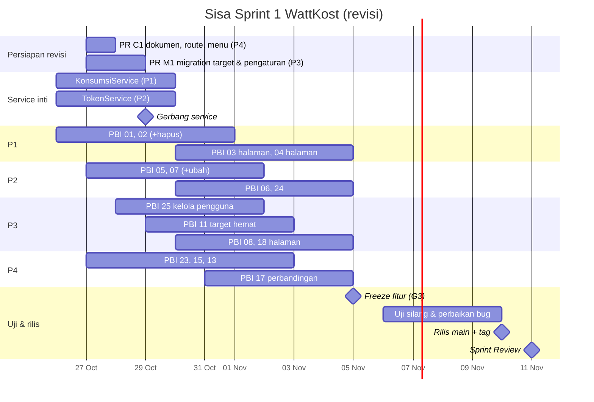

# Tahapan Sprint 1 — 16 PBI (revisi 26 Oktober 2026)

**14 Oktober – 11 November 2026** · 4 pasangan · 16 PBI + fondasi

> **Revisi 26 Okt:** dosen mewajibkan **2 PBI per anggota per sprint** dengan **minimal 1 PBI CRUD penuh** per anggota. Sprint 1 jadi **16 PBI** (4 per pasangan, 2 CRUD per pasangan). Tahap 0–1 (fondasi) sudah selesai. Jadwal Tahap 2–4 di bawah menggantikan jadwal lama. Rincian aturan & label CRUD: `docs/REVISI-PBI-SPRINT-1.md`.

Setiap tahap punya **gerbang**: syarat yang harus terpenuhi di branch `develop` sebelum lanjut. Sabtu–Minggu adalah cadangan.

## Pembagian
| Pasangan | PBI | CRUD penuh | Usulan per orang |
|---|---|---|---|
| P1 Tata + Eca | 01 alat, 02 pemakaian (+hapus), 03 estimasi, **04 peringkat** | 01, 02 | Tata 01+03 · Eca 02+04 |
| P2 Rafa + Beden | 05 token, 06 rekap, 07 sisa kWh (+ubah), **24 jejak karbon** | 05, 07 | Rafa 05+06 · Beden 07+24 |
| P3 Luthfan + Dhias | 08 prediksi, 18 biaya, **11 target hemat**, **25 kelola pengguna** | 11, 25 | Luthfan 08+11 · Dhias 18+25 |
| P4 Puti + Tika | 13 tips, 15 profil, 23 katalog, **17 perbandingan** | 13, 23 | Puti 23+15 · Tika 13+17 |



---

## Peta ketergantungan

```
PR C1 (P4: dokumen, route kosong, menu, config) ─┬─► PBI 25 kelola pengguna (P3)
                                                 ├─► PBI 17 perbandingan (P4) ◄── KonsumsiService
PR M1 (P3: tabel target_hemat, pengaturan) ──────┼─► PBI 11 target hemat (P3)  ◄── KonsumsiService + TarifService
                                                 └─► PBI 24 jejak karbon (P2)  ◄── KonsumsiService

PBI 1 → PBI 2 → KonsumsiService (P1) ──┬─► PBI 3, PBI 4 (P1)
                                       ├─► PBI 8 prediksi (P3) ◄── TokenService (P2) ◄── PBI 5, 7
                                       └─► PBI 18 biaya (P3) ◄── TarifService (P4) + TokenService::rekap
PBI 13, 15, 23 (P4) berdiri sendiri
```

**Jalur kritis:** `KonsumsiService` (P1) dan `TokenService` (P2). Keduanya **harus merge paling lambat Kamis 29 Okt**, karena 6 PBI menunggunya (04, 08, 11, 17, 18, 24). Sebelum itu, pasangan lain menulis unit test memakai *mock*, **tidak** menulis ulang rumusnya.

---

## TAHAP 0–1 — Fondasi ✅ selesai
Kerangka Laravel 12, database Sprint 1, komponen UI, auth, menu, pola CRUD modal, `x-pilih-bulan`, `x-chart`, `TarifService`, `PANDUAN-PROMPT.md`.

---

## TAHAP 1b — Persiapan revisi (Selasa 27 – Rabu 28 Okt)

| PR | Pemilik | Isi | Target merge |
|---|---|---|---|
| **C1** `chore/persiapan-pbi-tambahan` | P4 | `docs/REVISI-PBI-SPRINT-1.md`, spesifikasi PBI 11/17/24/25, update dokumen lama, file kosong `routes/modules/{target,perbandingan,karbon,pengguna}.php` + `require`, item menu baru, `faktor_emisi_default` | Sel 27 Okt |
| **M1** `chore/migration-pbi-tambahan` | P3 | Migration baru `target_hemat` & `pengaturan_pengguna`, model, relasi, factory, update `DATABASE.md` | Rab 28 Okt |

**Gerbang G1b (Rabu 28 Okt malam)**
- [ ] C1 dan M1 merge, `php artisan migrate:fresh --seed` jalan di laptop semua orang
- [ ] Semua anggota sudah tahu 2 PBI miliknya dan PBI CRUD-nya (konfirmasi di grup)

---

## TAHAP 2 — Service inti & PBI CRUD (Senin 26 Okt – Senin 2 Nov)

| Hari | P1 | P2 | P3 | P4 |
|---|---|---|---|---|
| **Sen 26 – Sel 27** | PBI 01 selesai → PR | `TokenService` + unit test → PR | Selesaikan PR service 04/08 (serahkan 04 ke P1) · PR M1 | PR C1 · mulai PBI 23 |
| **Rab 28** | PBI 02 + tombol Hapus | PBI 05 | PBI 25 (route, request, controller) | PBI 23 → PR |
| **Kam 29** | **`KonsumsiService` merge** | **`TokenService` merge** · PBI 05 → PR | PBI 25 view + test → PR | PBI 15 |
| **Jum 30** | PBI 02 → PR | PBI 07 + Ubah | PBI 11 (`TargetHematService` + test) | PBI 15 → PR · mulai PBI 13 |
| **Sab 31** *(cadangan)* | | | | |
| **Sen 2 Nov** | PBI 03 halaman | PBI 07 → PR | PBI 11 halaman + test → PR | PBI 13 → PR |

**Gerbang G2 (Senin 2 Nov malam)** — 8 PBI CRUD (syarat dosen) + 15 merge: **01, 02, 05, 07, 11, 13, 15, 23, 25**. Skenario end-to-end dicoba orang dari pasangan lain.

---

## TAHAP 3 — Tampilan hitungan (Sabtu 31 Okt – Rabu 4 Nov)

| Hari | P1 | P2 | P3 | P4 |
|---|---|---|---|---|
| **Sel 3 Nov** | PBI 03 → PR · PBI 04 halaman | PBI 06 → PR | PBI 08 halaman → PR | PBI 17 (`PerbandinganService` + halaman) |
| **Rab 4 Nov** | PBI 04 → PR | PBI 24 → PR | PBI 18 halaman → PR | PBI 17 → PR · kartu Beranda |

**Gerbang G3 (Kamis 5 Nov) — Freeze fitur**
- [ ] 16 PBI merge di `develop`: 1, 2, 3, 4, 5, 6, 7, 8, 11, 13, 15, 17, 18, 23, 24, 25
- [ ] Setiap PBI CRUD bisa didemokan tambah, lihat, ubah, hapus
- [ ] Contoh angka di spesifikasi cocok saat dicoba manual (PBI 3, 4, 6, 8, 11, 17, 18, 24)
- [ ] Mulai Jumat 6 Nov: hanya perbaikan bug

---

## TAHAP 4 — Uji & rilis (Jumat 6 – Rabu 11 Nov)

| Hari | Kegiatan |
|---|---|
| **Jum 6** | Uji silang: P1 menguji P2, P2 → P3, P3 → P4, P4 → P1. Bug dicatat sebagai GitHub Issue berlabel `bug` (langkah + screenshot). Uji keamanan: ubah ID di URL → harus 403/404. |
| **Sen 9** | Perbaikan bug (`fix/...`, PR kecil). Seeder data demo final. README, `PERUBAHAN-RANCANGAN.md`, `docs/ai-log/` lengkap. |
| **Sel 10** | Gladi Sprint Review (AI membaca repo & proposal, perbaiki yang kecil, catat sisanya). PM: PR `develop` → `main`, tag `v0.1-sprint1`. Naskah demo: tiap orang mendemokan 2 PBI-nya. |
| **Rab 11** | **Sprint Review** + Retrospective + Sprint Planning 2 |

**Gerbang G4 (Selasa 10 Nov):** tidak ada bug prioritas tinggi terbuka · `main` = `develop`, CI hijau · repo bisa di-clone & dijalankan ikut README · tidak ada `.env` di riwayat · log prompt AI lengkap.

---

## Daftar PR tersisa
| PR | Isi | Pasangan | Target merge | Bergantung pada |
|---|---|---|---|---|
| C1 | Persiapan PBI tambahan | P4 | Sel 27 Okt | — |
| M1 | Migration target & pengaturan | P3 | Rab 28 Okt | C1 |
| svc-P3 | `PeringkatAlatService`, `PrediksiTokenService` | P3 | Sel 27 Okt | — |
| 1a | PBI 01 | P1 | Sel 27 Okt | — |
| svc-P2 | `TokenService` | P2 | **Kam 29 Okt** | — |
| 3a | `KonsumsiService` | P1 | **Kam 29 Okt** | — |
| 23a | PBI 23 | P4 | Rab 28 Okt | — |
| 25a | PBI 25 | P3 | Kam 29 Okt | C1 |
| 5a | PBI 05 | P2 | Kam 29 Okt | — |
| 2a | PBI 02 (+hapus) | P1 | Jum 30 Okt | 1a |
| 15a | PBI 15 | P4 | Jum 30 Okt | — |
| 7a | PBI 07 (+ubah) | P2 | Sen 2 Nov | svc-P2 |
| 11a | PBI 11 | P3 | Sen 2 Nov | M1, 3a |
| 13a | PBI 13 | P4 | Sen 2 Nov | — |
| 3b | PBI 03 halaman | P1 | Sel 3 Nov | 3a |
| 6a | PBI 06 | P2 | Sel 3 Nov | svc-P2 |
| 8a | PBI 08 halaman | P3 | Sel 3 Nov | 3a, svc-P2 |
| 4a | PBI 04 halaman | P1 | Rab 4 Nov | 3a, svc-P3 |
| 24a | PBI 24 | P2 | Rab 4 Nov | M1, 3a |
| 18a | PBI 18 | P3 | Rab 4 Nov | 3a, svc-P2 |
| 17a | PBI 17 | P4 | Rab 4 Nov | C1, 3a |
| B1 | Kartu Beranda | P4 | Rab 4 Nov | 3a, svc-P2 |
| fix/* | Perbaikan bug | semua | 6–9 Nov | G3 |

---

## Rencana darurat
| Prioritas | PBI | Alasan |
|---|---|---|
| **Wajib (syarat dosen)** | 01, 02, 05, 07, 11, 13, 23, 25 (CRUD) | Tiap anggota harus punya 1 PBI CRUD penuh |
| **Wajib (inti)** | 03, 15, 06, 08, 18 | Jalur hitungan utama |
| **Penting** | 04, 17, 24 | Ringan, tinggal memanggil `KonsumsiService` |

| Tanda bahaya | Tindakan |
|---|---|
| `KonsumsiService` / `TokenService` belum merge Kamis 29 Okt | Pasangan pemilik berhenti dari pekerjaan lain; satu orang P3 ikut *pair* |
| C1 / M1 belum merge Rabu 28 Okt | P4/P3 prioritaskan; PBI 25 & 17 boleh mulai di cabang, merge setelah C1 |
| PR menunggu review > 1 hari | Scrum Master menunjuk reviewer pengganti |
| CI merah di `develop` | Semua berhenti merge sampai hijau; pemilik PR terakhir memperbaiki |
| Konflik yang tidak bisa diselesaikan | Jangan dipaksa; kirim `git status` + `git diff` ke grup atau ke Claude di chat |

## Ritme rutin
- **Setiap pagi:** `git switch develop && git pull`, lalu di cabang kerja `git merge develop`. Daily Scrum 15 menit di grup.
- **Setiap merge ke develop:** umumkan di grup.
- **Akhir tiap minggu:** PO Tika memperbarui GitHub Project (16 kartu PBI); PM mencatat progres.
